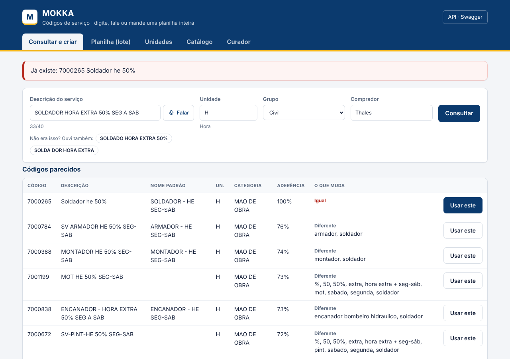
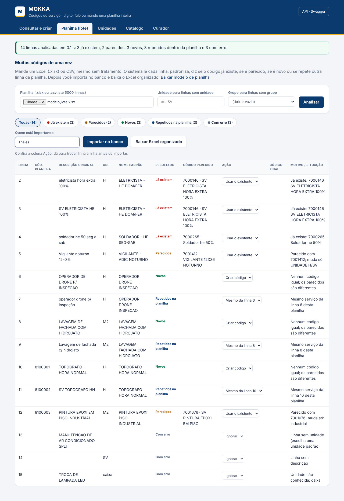
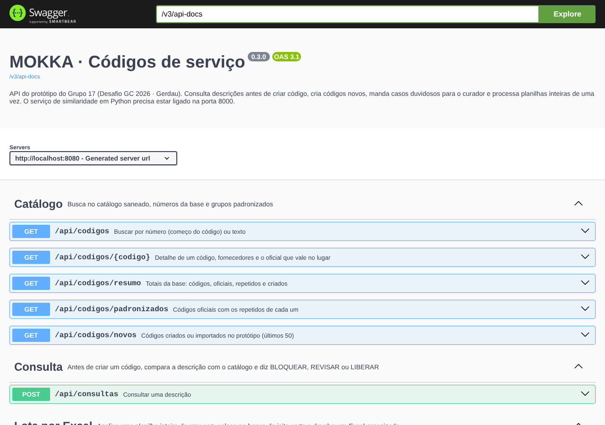

# MOKKA · Códigos de serviço (Desafio GC 2026 · Gerdau)

Protótipo do Grupo 17 para acabar com os códigos de serviço repetidos no SAP. Antes de criar um código, o comprador digita ou **fala** a descrição. O sistema mostra os códigos parecidos que já existem e dá um de três resultados:

- **BLOQUEAR**: já existe um código igual.
- **REVISAR**: existe um quase igual, e para criar mesmo assim é preciso justificar.
- **LIBERAR**: é novo, e o código é criado na hora.

Quem insiste em criar um código bloqueado vai para a fila do **curador**. Para a alta demanda, uma **planilha inteira** (até 5000 linhas, mesmo sem tratamento) é analisada de uma vez, entra no banco do jeito certo e volta como um Excel organizado.

| Consulta por voz | Planilha inteira | API (Swagger) |
| --- | --- | --- |
|  |  |  |

## Rodar do zero

Estes são os passos exatos para quem nunca abriu o projeto.

### 1. Instale (uma vez só)

| Programa | Versão | Onde baixar |
| --- | --- | --- |
| Git | qualquer | https://git-scm.com |
| Java (JDK) | 17 ou mais novo | https://adoptium.net (Temurin 17) |
| Python | 3.11, 3.12 ou 3.13 | https://www.python.org/downloads (marque "Add python.exe to PATH") |
| Navegador | Chrome ou Edge | a voz só funciona nesses dois |

Para conferir, abra o terminal (PowerShell no Windows) e rode `git --version`, `java -version` e `python --version`.

### 2. Baixe o projeto

```
git clone https://github.com/LeonardoLopesMMZ/DESAFIO-GC-GERDAU.git
cd DESAFIO-GC-GERDAU
```

Quem não usa Git pode baixar pelo GitHub: botão verde **Code > Download ZIP**, e depois extrair o zip.

### 3. Ligue o sistema

**Windows:** dê dois cliques em **`iniciar.bat`**.

Na primeira vez ele faz três coisas, que levam de 3 a 5 minutos e precisam de internet:

- prepara o Python;
- compila o Java;
- monta o catálogo.

Depois disso o sistema liga em uns 30 segundos, também sem internet. O navegador abre sozinho em **http://localhost:8080**. Para desligar, use o **`parar.bat`**.

**Linux ou Mac**, em dois terminais:

```
cd saneamento
python3 -m venv .venv && . .venv/bin/activate
pip install pandas numpy scikit-learn openpyxl
python exportar.py exemplo/base_exemplo.csv --tudo
python api.py exemplo/base_exemplo.csv
```

```
cd codigos-api
./mvnw -DskipTests package
java -jar target/codigos-api-0.3.0.jar --spring.sql.init.data-locations=file:../saneamento/saida/data.sql --spring.sql.init.encoding=UTF-8
```

### 4. Teste

Siga o roteiro [docs/COMO_TESTAR.md](docs/COMO_TESTAR.md): 12 testes curtos, cada um com o resultado esperado.

### Sobre a base de dados

A planilha da Gerdau é confidencial e **não está no repositório**. Por isso o projeto traz uma **base de exemplo fictícia** (`saneamento/exemplo/base_exemplo.csv`), com 337 códigos inventados no mesmo formato e com os mesmos tipos de bagunça: abreviações, maiúsculas e minúsculas, "SV-" na frente, o mesmo serviço com códigos diferentes. Ela é usada automaticamente.

Quem tem a base real coloca o arquivo em `saneamento/dados/base_codigos_servico.xlsx` e roda o `iniciar.bat` de novo. Ele passa a usar a real; o `.gitignore` impede que ela suba para o GitHub.

## O que o sistema faz

| Aba | O que dá para fazer |
| --- | --- |
| Consultar e criar | Digitar ou **falar** a descrição. Ver os parecidos com a aderência e o que muda em cada um. Usar um existente ou criar um novo. Se houver erro de digitação ou de fala ("SOLDA DOR"), o sistema sugere a correção ("SOLDADOR") e mostra que o código já existe. |
| Planilha (lote) | Mandar um .xlsx ou .csv bruto. Ver linha a linha: já existe, parecido, novo, repetido dentro da própria planilha ou com erro. Trocar a ação de cada linha. Importar tudo numa transação só. Baixar o Excel organizado com as abas Tratado, Pronto para o SAP e Resumo. |
| Unidades | Ver como escrever cada unidade. Na consulta dá para escrever "hora" ou "metro quadrado", e a tela troca por H ou M2. |
| Catálogo | Ver os números da base, os códigos oficiais com os repetidos de cada um e os códigos criados ou importados. Buscar por número ou texto, também por voz. |
| Curador | Aprovar ou recusar quem quis criar um código que já existe. |

A planilha do lote é lida por nome de coluna ("Descrição", "Unidade", "Grupo", "Código", "Fornecedor"), em qualquer ordem. Ela pode ter também as 5 colunas no formato da Gerdau, ou uma coluna só com as descrições. O modelo pode ser baixado na própria aba.

## Como funciona por dentro

```
Navegador (HTML + JS)  ->  Java / Spring Boot (porta 8080)  ->  Python (porta 8000)
                              |  regras, API REST, Swagger         limpeza, padronização,
                              |  curador, importação               similaridade, Excel
                              v
                        Banco: H2 em memória (demonstração) ou PostgreSQL (produção)
```

- **Python** (`saneamento/`):
  - limpa e padroniza as descrições, com 118 abreviações e o limite de 40 caracteres;
  - acha os repetidos da base e compara textos com TF-IDF de pedaços de 2 a 4 letras, mais uma régua de regras: cargo, tipo de hora, percentual, unidade;
  - corrige palavras erradas comparando com o vocabulário do catálogo;
  - lê e escreve Excel.
- **Java** (`codigos-api/`):
  - recebe as consultas e guarda cada decisão (quem, o que foi sugerido, o que foi escolhido e por quê);
  - controla o curador e faz a importação em lote numa transação só;
  - publica a API com Swagger e devolve erros sempre em português, no formato `{"status", "erro", "caminho", "quando"}`.
- **Banco**: tabelas `base_original` (intocada), `codigo_servico`, `codigo_fornecedor`, `dicionario` e `solicitacao`, mais a sequência `codigo_novo` (a partir de 9000001). Os detalhes estão em [docs/14-modelagem-banco](docs/14-modelagem-banco/README.md).

## API

A documentação completa e testável fica em **http://localhost:8080/swagger** com o sistema ligado.

| Método | Caminho | O que faz |
| --- | --- | --- |
| POST | `/api/consultas` | consulta uma descrição; devolve o resultado, os candidatos e a correção sugerida |
| POST | `/api/solicitacoes/{id}/decisao` | usar um código existente ou criar um novo |
| POST | `/api/solicitacoes/{id}/curadoria` | o curador aprova ou recusa |
| GET | `/api/solicitacoes` | histórico de consultas e decisões |
| POST | `/api/lotes/analisar` | analisa uma planilha (multipart, campo `arquivo`) |
| POST | `/api/lotes/importar` | grava as linhas analisadas no banco |
| POST | `/api/lotes/exportar` | devolve o Excel organizado |
| GET | `/api/codigos?busca=` | busca no catálogo |
| GET | `/api/codigos/resumo` | totais da base |
| GET | `/api/codigos/padronizados` | códigos oficiais com os repetidos |
| GET | `/api/codigos/novos` | códigos criados ou importados |
| GET | `/api/codigos/{codigo}` | um código e o oficial que vale no lugar dele |
| GET | `/api/unidades` | unidades, sinônimos e exemplos |

## Apresentar sem susto (Teams ou ao vivo)

- **Ligue 5 minutos antes** com o `iniciar.bat` e deixe a aba aberta. Tudo roda no próprio computador e não depende de internet, menos a voz.
- **Compartilhe a janela do navegador** no Teams, não a tela inteira: as janelas pretas do Python e do Java ficam fora.
- **Voz:** use o Chrome ou o Edge em `http://localhost:8080`. Ela precisa de internet; se cair, digite, que todo o resto continua funcionando.
- **Para começar do zero entre ensaios**, rode o `iniciar.bat` de novo: o banco de demonstração é em memória.
- **Para o grupo acessar junto**, outros computadores na **mesma rede** abrem o endereço que o `iniciar.bat` mostra no fim (`http://192.168.x.x:8080`). Se o Firewall perguntar, permita em "Redes privadas". Por Teams, de casas diferentes, isso não funciona: aí só quem está ligado compartilha a tela.

## Como mexer no código

- **Java:**
  - No IntelliJ IDEA, faça File > Open, escolha a pasta `codigos-api` e espere o Maven carregar.
  - Para rodar, use a classe `CodigosApplication` com o argumento `--spring.sql.init.data-locations=file:../saneamento/saida/data.sql`.
  - O serviço Python precisa estar ligado.
- **Python:** no VS Code, abra a pasta `saneamento` e escolha o interpretador `.venv` que o `iniciar.bat` criou.
- **Tela:** é um arquivo só, `codigos-api/src/main/resources/static/index.html`, e a conversão de fala em texto fica em `fala.js` na mesma pasta.

Depois de mudar o Java, apague a pasta `codigos-api/target` para o `iniciar.bat` compilar de novo.

## Problemas comuns

| Problema | Causa provável | O que fazer |
| --- | --- | --- |
| "Java não encontrado" | JDK não instalado ou fora do PATH | Instale o Temurin 17 e abra o `iniciar.bat` de novo |
| Falha ao preparar o Python | sem internet ou Python 3.14+ sem pacotes prontos | Instale o Python 3.12 e apague `saneamento/.venv` |
| "O serviço de similaridade está fora do ar" | a janela do Python foi fechada | Rode o `iniciar.bat` de novo |
| O botão Falar está cinza | Firefox, ou página aberta pelo IP | Use o Chrome ou o Edge em `http://localhost:8080` |
| "O reconhecimento de voz precisa de internet" | sem internet | Digite a descrição |
| Outro computador não abre | Firewall do Windows | Permita o Java em "Redes privadas" |
| A tela parece antiga | cache do navegador | Ctrl+F5 |

## Testes automáticos

```
cd saneamento
python test_padronizar.py
```

A documentação de cada etapa está em `saneamento/docs/` (dados) e `docs/` (Java, banco e telas).

## Equipe

Grupo 17, Desafio GC 2026: Leonardo Lopes, Thales, Thirza Midiã Matos de Oliveira, Bárbara Teixeira Baumgardt, Lukas Leimann.
