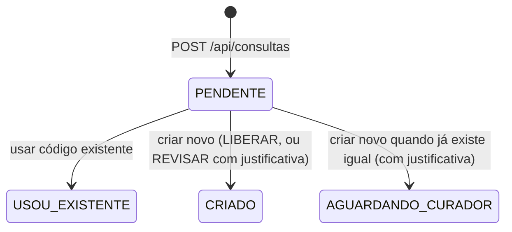

# 10 · Persistência inicial

> **O que pede:** estrutura mínima para armazenar catálogo e informações necessárias ao fluxo.
> **Critério de aceite:** a aplicação consegue gravar e consultar os dados essenciais.

A aplicação **lê** o catálogo saneado e **grava** cada consulta e a decisão do comprador. Funciona em dois bancos com o mesmo `schema.sql`: H2 em memória (para rodar sem instalar nada) e PostgreSQL 16 (banco de verdade).

## O que é gravado e o que é consultado

| Tabela | A aplicação... | Para quê |
| --- | --- | --- |
| `codigo_servico` | consulta | catálogo: código, textos, nome padrão, categoria, status e código oficial |
| `codigo_fornecedor` | consulta | quais fornecedores usam cada código |
| `solicitacao` | grava e consulta | cada consulta feita na tela, o resultado, os candidatos mostrados e a decisão |
| `base_original` | — | a base da Gerdau como veio, para auditoria (pasta 14) |
| `dicionario` | — | as abreviações, para quem mantém o dicionário |

## Ciclo de vida de uma solicitação

A justificativa é exigida pelo servidor, a partir do resultado que ele mesmo gravou na consulta. Não dá para pular a regra mexendo no navegador.

## Governança proposta (para validar com a Gerdau em 19/10)

| Resultado | O que acontece | Quem decide |
| --- | --- | --- |
| LIBERAR (nada igual) | o código é criado na hora | comprador |
| REVISAR (quase igual) | o comprador usa o existente ou cria com justificativa; o curador revisa as criações da semana em lote | comprador, com revisão depois |
| BLOQUEAR (já existe igual) | o comprador usa o existente; criar mesmo assim vai para o curador, que responde em até 24 h | curador |

Um curador por grupo (Civil, Facilities, Eletromecânica). Segue o que a Gerdau pediu: o comprador decide, e o segundo aprovador só entra na exceção, sem travar o processo. A tela do curador é o próximo passo (V2); hoje a fila já pode ser vista em `GET /api/solicitacoes?status=AGUARDANDO_CURADOR`.

## Evidência: gravado no PostgreSQL

Consultas feitas pela tela (pasta 11) e lidas direto do banco:

| id | descrição digitada | resultado | sugerido | escolhido | status | justificativa |
| --- | --- | --- | --- | --- | --- | --- |
| 1 | MEC.MANUT.NORM | BLOQUEAR | 4083559 | 4083559 | USOU_EXISTENTE | |
| 2 | SOLDADOR HE 50% SEG A SAB | REVISAR | 4051912 | | CRIADO | Soldador com certificação 6G, valor diferente |
| 3 | PINTURA EPOXI PISO | LIBERAR | 4033516 | | CRIADO | |
| 4 | tec seg trab HE 100% dom | BLOQUEAR | 4096236 | | AGUARDANDO_CURADOR | Equipe para trabalho em altura |
| 5 | VIGILANTE 12X36 NOTURNO | BLOQUEAR | 4122123 | 4122123 | USOU_EXISTENTE | |

## Evidência: consultado pela API

- `exemplo_solicitacao_gravada.json`: resposta de `POST /api/solicitacoes/5/decisao`, com a linha gravada, incluindo os 10 candidatos mostrados ao comprador.
- `exemplo_codigo_com_oficial.json`: resposta de `GET /api/codigos/4071563`. O código está BLOQUEADO, e a API devolve junto o oficial `4076413`, lido do catálogo saneado.

## Onde está no código

| Arquivo | Papel |
| --- | --- |
| `catalogo\CodigoServico.java` | mapeia a tabela `codigo_servico` |
| `catalogo\CodigoServicoRepository.java` | busca por trecho e fornecedores de um código |
| `solicitacao\Solicitacao.java` | mapeia a tabela `solicitacao` e aplica a regra de decisão |
| `solicitacao\SolicitacaoRepository.java` | lista as últimas solicitações e a fila do curador |
| `resources\application.yml` | H2 por padrão; perfil `postgres` para o banco de verdade |

**Como verificar:** com a aplicação rodando, abra `http://localhost:8080/h2-console` (JDBC URL `jdbc:h2:mem:codigos`, usuário `sa`) e consulte `SELECT * FROM solicitacao`. No PostgreSQL, a mesma consulta pelo psql ou DBeaver.
