# 11 · Fluxo de consulta V1

> **O que pede:** usuário informa uma descrição → Java realiza a consulta → recebe candidatos semelhantes.
> **Critério de aceite:** o mentor consegue executar uma consulta e visualizar os candidatos retornados.

A tela fica em **http://localhost:8080** e é servida pela própria aplicação Java. Não precisa instalar nada além do que está no passo a passo.

## Passo a passo para o mentor

1. Na pasta `saneamento`: `python api.py dados\base_codigos_servico.xlsx` e espere o "ok:".
2. Na pasta `codigos-api`: `.\mvnw.cmd spring-boot:run` e espere "Started CodigosApplication".
3. Abra http://localhost:8080, digite uma descrição, a unidade e seu nome, e clique **Consultar**.
4. Veja o resultado no topo e os candidatos na tabela, com o que muda em cada um.
5. Clique **Usar este** em um candidato, ou escreva uma justificativa e clique **Criar código novo**.
6. Role até **Solicitações recentes**: a consulta e a decisão ficaram gravadas.

## Telas (capturadas da aplicação rodando)

**1. Já existe igual** — "MEC.MANUT.NORM", unidade H. O primeiro candidato é o mesmo serviço; o botão dele vem destacado.

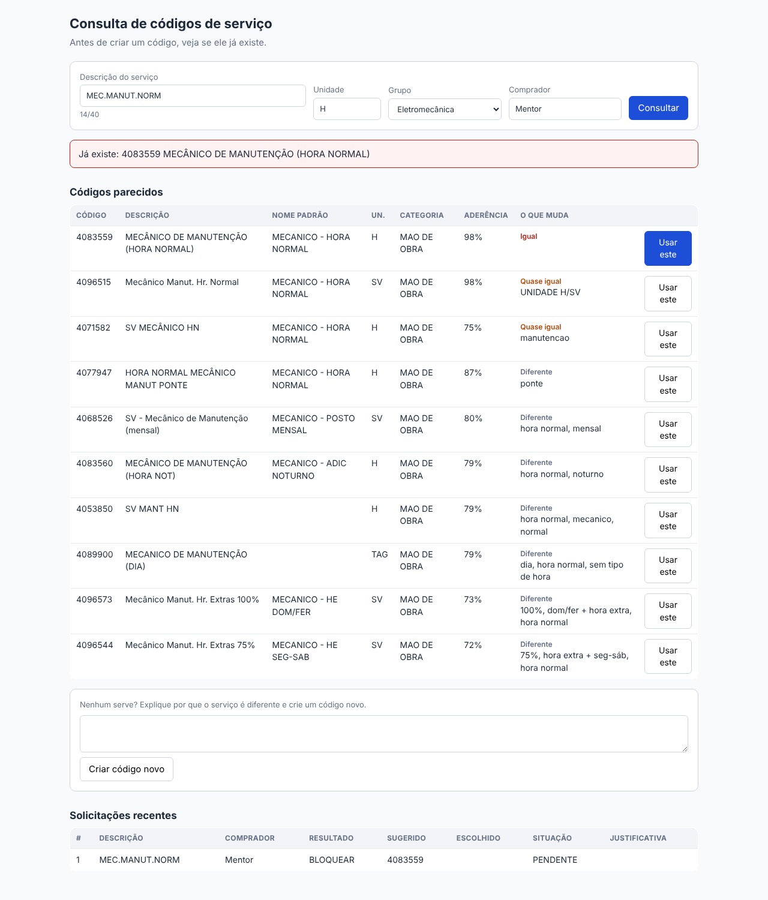

**2. Comprador usa o código existente** — nenhum código novo é criado.

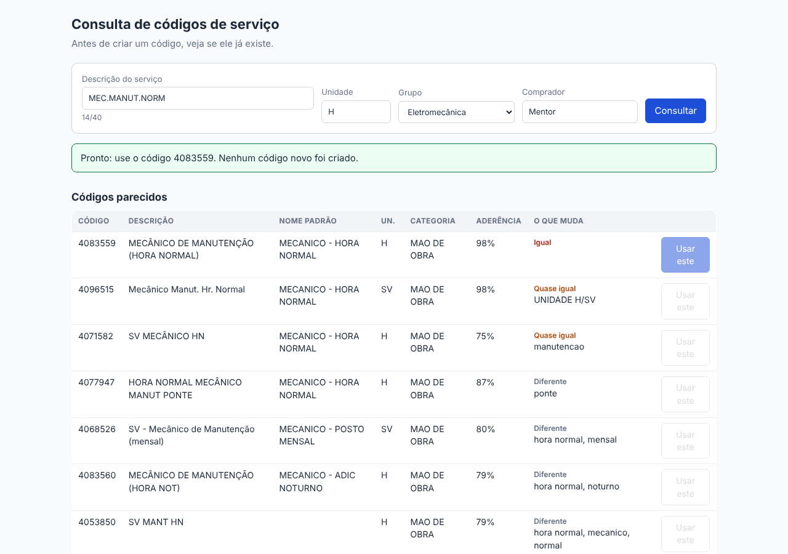

**3. Quase igual** — "SOLDADOR HE 50% SEG A SAB". O sistema mostra que muda só a unidade e a palavra ADM; os de percentual diferente ficam embaixo.

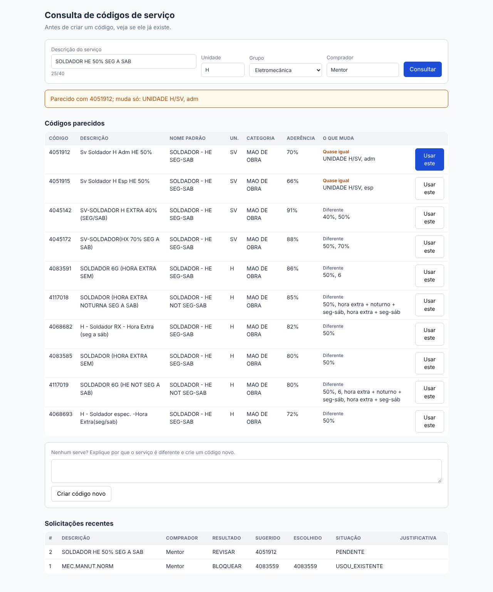

**4. Nada igual** — "PINTURA EPOXI PISO", M2. Os parecidos são outros serviços; criar é liberado.

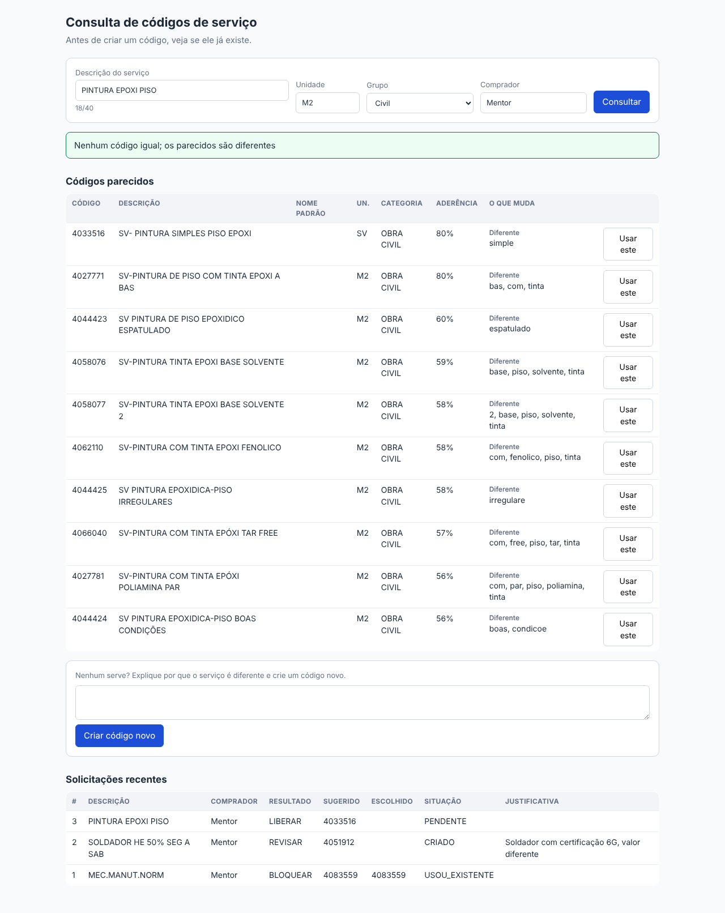

**5. Justificativa obrigatória** — tentar criar um código quando já existe igual pede justificativa.

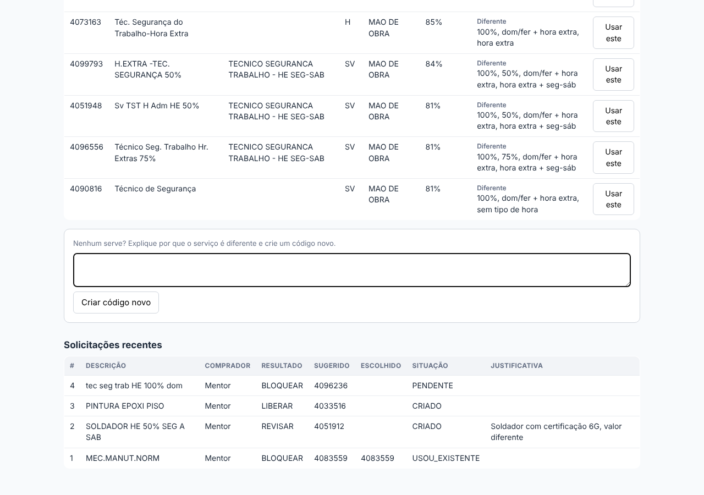

**6. Tudo gravado** — a lista mostra o que foi sugerido, o que o comprador escolheu e a situação de cada pedido.

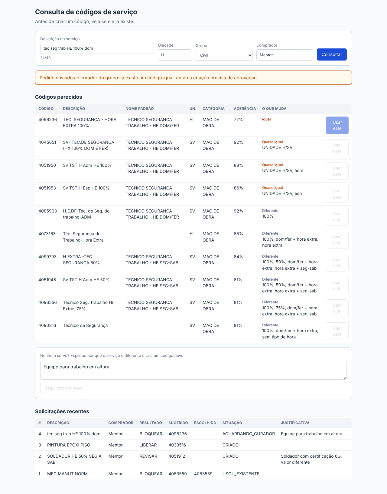

## Roteiro de demonstração (5 minutos)

| Digite | Unidade | O que mostrar |
| --- | --- | --- |
| MEC.MANUT.NORM | H | abreviações viram "mecânico de manutenção hora normal"; já existe |
| SOLDADOR HE 50% SEG A SAB | H | o sistema explica o que muda em vez de dar só uma nota |
| tec seg trab HE 100% dom | H | minúscula e abreviação não enganam; criar exige justificativa |
| PINTURA EPOXI PISO | M2 | nada igual: criação liberada |

## Fluxo completo: criar, consultar de novo, catálogo e curador

A tela tem quatro abas: **Consultar e criar**, **Unidades**, **Catálogo** e **Curador**.

1. **Criar.** Quando não existe igual, **Criar código novo** cria o código na hora (os novos começam em 9000001), grava no catálogo e ensina o serviço de similaridade.

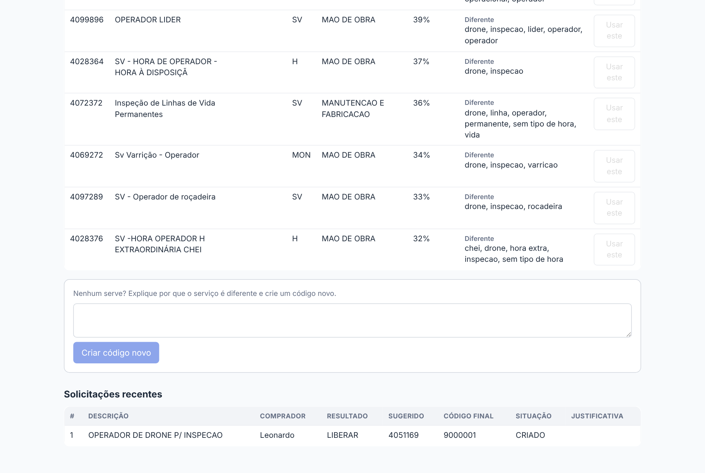

2. **Consultar de novo.** O mesmo serviço consultado outra vez já volta como **Já existe**, apontando para o código recém-criado. É o duplicado sendo barrado.

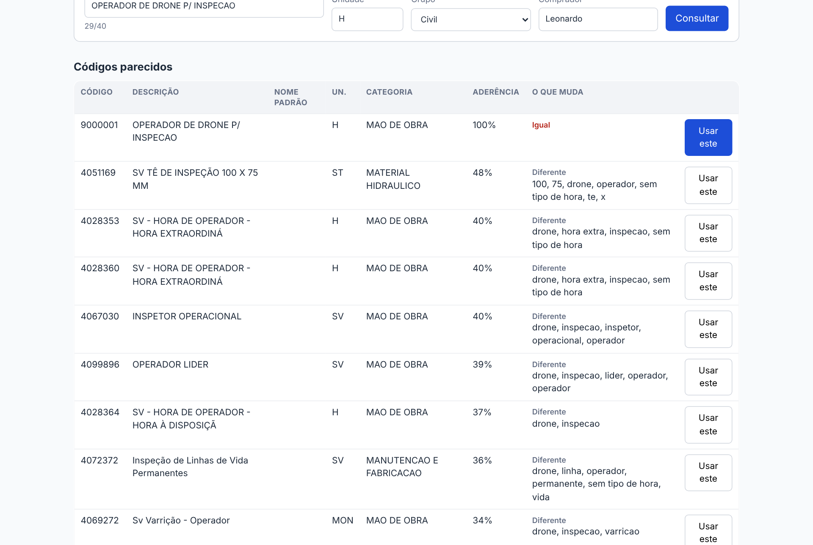

3. **Curador.** Se o comprador insiste em criar quando já existe igual, o pedido vai para a aba **Curador**. Aprovar cria o código; recusar manda usar o existente.

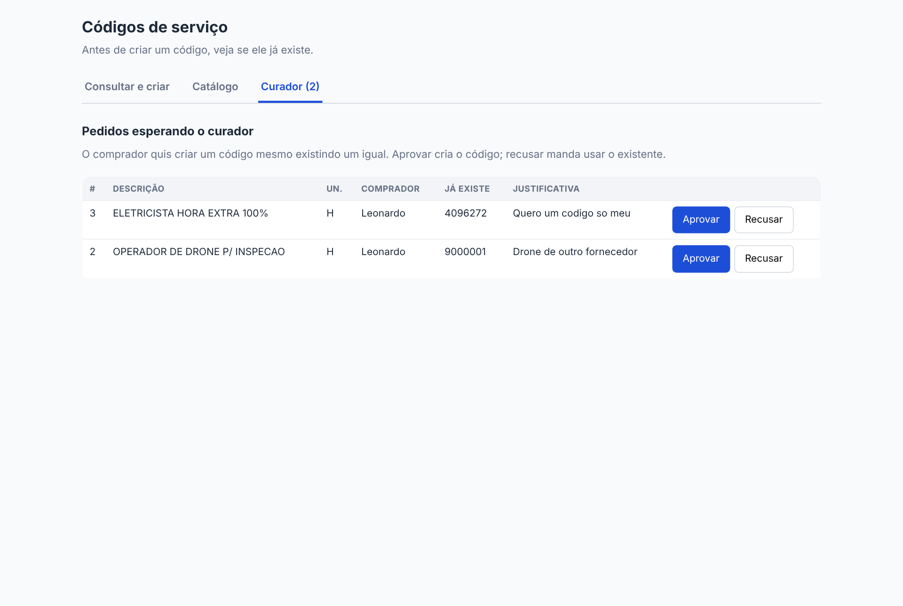

4. **Catálogo.** Busca por descrição ou número do código. Sem busca, mostra os códigos criados agora. A situação diz se o código é ativo, novo ou repetido (e qual usar no lugar).

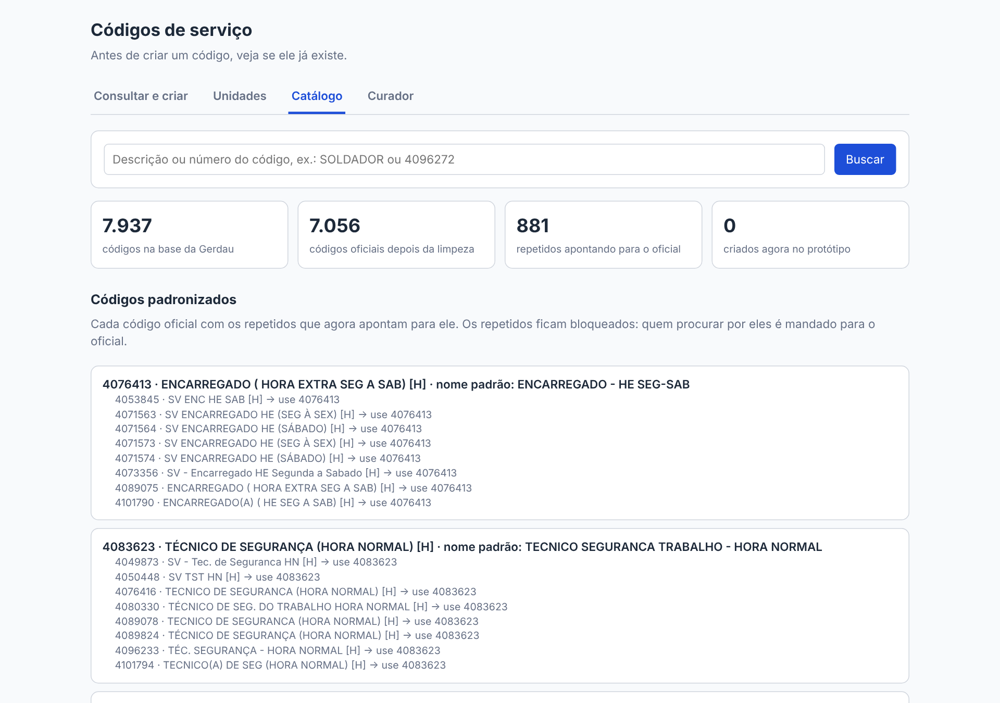

5. **Unidades.** Mostra as 17 unidades da base com o código do SAP, o que cada uma é, como dá para escrever e exemplos reais. Na consulta dá para digitar "hora" ou "metro quadrado" e a tela troca por H ou M2.

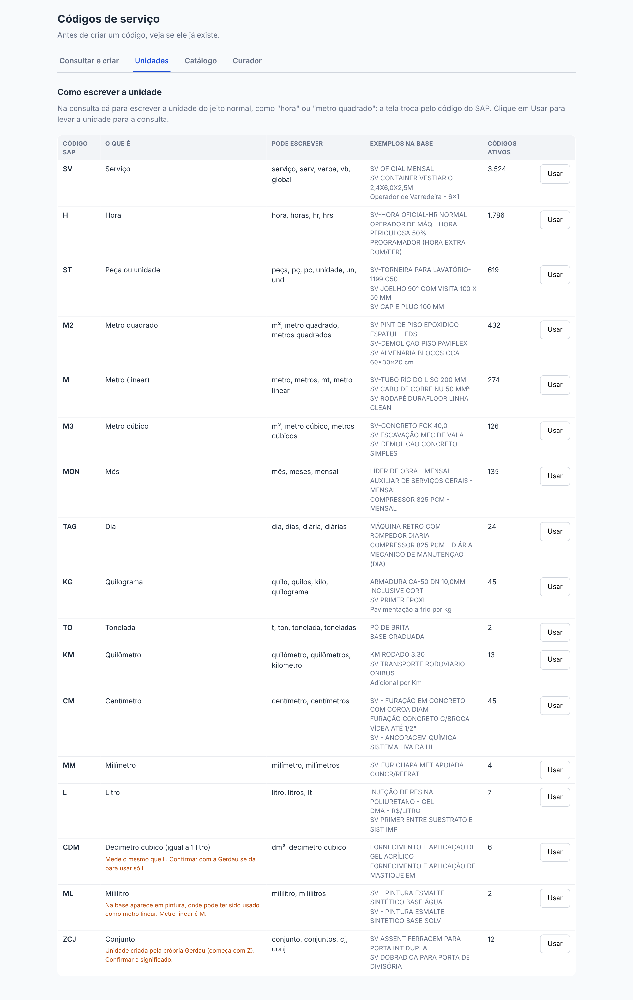
