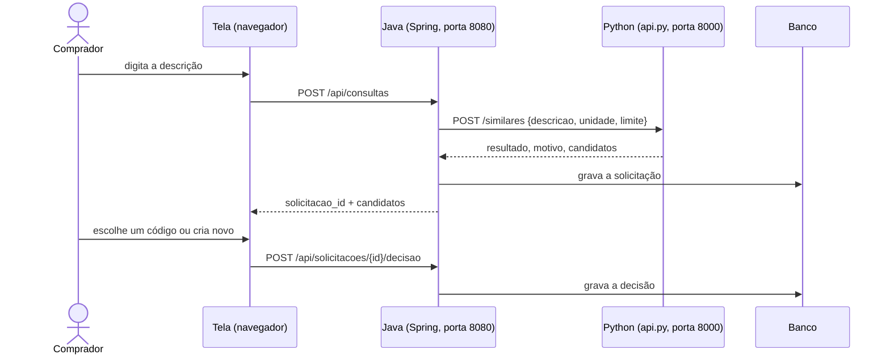

# 12 · Integração V1

> **O que pede:** comunicação entre Java e a lógica de similaridade.
> **Critério de aceite:** o fluxo funciona sem copiar ou editar manualmente os resultados entre as duas partes.

O Java e o Python conversam por **HTTP com JSON**. O Python fica no ar como um serviço (`api.py`, porta 8000) e o Java chama esse serviço a cada consulta. Ninguém copia resultado de um lado para o outro.

## Como as partes se falam



Os dois lados usam o **mesmo banco e o mesmo schema.sql**: o Python carrega o catálogo saneado (`exportar.py --db`), e o Java lê esse catálogo e grava as solicitações.

## O contrato entre Java e Python

```http
POST http://127.0.0.1:8000/similares
Content-Type: application/json

{"descricao": "MEC.MANUT.NORM", "unidade": "H", "limite": 10}
```

Resposta: `resultado`, `motivo` e `candidatos` (o mesmo formato da pasta 09). No Java, o contrato está escrito nos records `Resposta`, `Candidato` e `Origem` de `consulta\SimilaridadeClient.java`.

## Evidência de que funciona sem cópia manual

Log do Python durante a demonstração da pasta 11: as quatro consultas feitas na tela e a do exemplo da pasta 09 geraram, cada uma, uma chamada do Java.

```
127.0.0.1 - - [13/Oct/2026 21:40:38] "POST /similares HTTP/1.1" 200 -
127.0.0.1 - - [13/Oct/2026 21:40:40] "POST /similares HTTP/1.1" 200 -
127.0.0.1 - - [13/Oct/2026 21:40:41] "POST /similares HTTP/1.1" 200 -
127.0.0.1 - - [13/Oct/2026 21:40:42] "POST /similares HTTP/1.1" 200 -
127.0.0.1 - - [13/Oct/2026 21:40:52] "POST /similares HTTP/1.1" 200 -
```

## Quando algo dá errado

| Situação | O que o Java faz |
| --- | --- |
| Python fora do ar | responde 503: "Serviço de similaridade fora do ar. Rode na pasta python: python api.py" |
| Python responde com erro | responde 502 com a mensagem do Python |
| Python em outra máquina | basta definir `SIMILARIDADE_URL=http://maquina:8000` antes de subir o Java |

Durante a integração encontramos um problema real: o cliente HTTP do Java envia o corpo em partes (chunked), e a API Python só aceitava corpo com tamanho declarado. Corrigimos o `api.py` para aceitar os dois jeitos, e o teste `test_api_devolve_candidatos` passou a cobrir esse caso.

## Por que HTTP e não outra forma

- O Java não precisa reescrever a lógica de similaridade: há uma só versão da regra, no Python.
- Cada parte pode ser testada sozinha (Python com `test_padronizar.py`, Java com a tela ou o PowerShell).
- É o formato que o Java já usa para qualquer serviço externo; trocar o Python por outra implementação não muda o Java.
