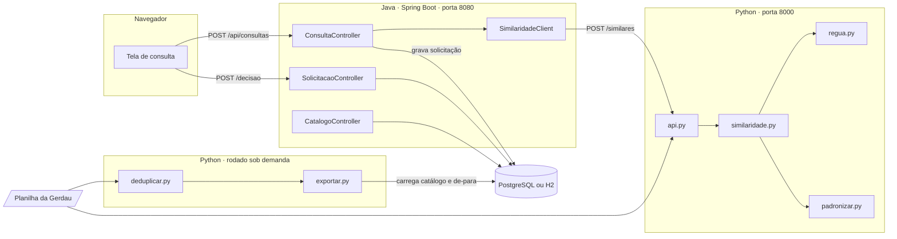

# 13 · Documentação

> **O que pede:** arquitetura, critérios, limitações e instruções de uso.
> **Critério de aceite:** a solução pode ser compreendida por alguém que não participou do desenvolvimento.

## O problema em uma frase

Cerca de 20 compradores criam códigos de serviço no SAP logo depois de negociar, copiando o texto do fornecedor e sem consultar o que já existe. O resultado é o mesmo serviço com dezenas de códigos (28 só para "técnico de segurança, hora extra dom/fer"), o que impede comparar preços e somar gastos.

## A solução em duas frentes

1. **Limpar o que já existe:** padronizar os 7.937 códigos, achar os repetidos automaticamente e propor um catálogo com um código oficial por serviço (7.056; 6.619 com as decisões da Gerdau), sem apagar nada.
2. **Evitar novos repetidos:** antes de criar um código, o comprador digita a descrição e vê em menos de um segundo se já existe igual, quase igual ou nada igual.

## Arquitetura



| Peça | Tecnologia | Responsabilidade |
| --- | --- | --- |
| `padronizar.py` | Python | regras de limpeza do texto, dicionário, leitura de cargo, tipo de hora e categoria |
| `regua.py` | Python | compara dois textos e diz DUPLICADO, REVISAR ou DIFERENTE, com o que muda |
| `deduplicar.py` | Python, pandas | acha os repetidos na base inteira e gera catálogo, de-para e decisões |
| `limpar.py` / `diagnostico.py` | Python, pandas | planilha limpa para Excel; diagnóstico e EDA |
| `similaridade.py` / `api.py` | Python, scikit-learn | busca de similares e servidor HTTP para o Java |
| `exportar.py` | Python, SQLAlchemy | monta as tabelas e carrega no PostgreSQL |
| `codigos-api` | Java 17, Spring Boot 3.5 | API Java, tela, regra de decisão e persistência |
| Banco | PostgreSQL 16 ou H2 | base original, catálogo saneado, solicitações |

Tudo roda num notebook comum, sem internet (depois de instalar) e sem serviço pago.

## Critérios (resumo)

| Tema | Critério | Detalhes |
| --- | --- | --- |
| Padronização | 6 etapas fixas, dicionário de 118 termos, número nunca some | pasta 03 |
| Similaridade | o que sobra de diferente decide: nada ou abreviação = igual; número, tipo de hora ou especialidade = diferente | pasta 04 |
| Juntar códigos | na dúvida, não junta; texto cortado não junta; sem encadeamento A~B~C | pasta 06 |
| Código oficial | o usado por mais fornecedores; empate, o menor número | pasta 06 |
| Ranking | classe, depois aderência, depois código | pasta 08 |
| Governança | LIBERAR cria na hora; REVISAR exige justificativa; BLOQUEAR vai para o curador | pasta 10 |

## Limitações

- Não há data, valor nem quantidade por código na base: não dá para medir economia em reais nem saber qual código é mais usado em compras.
- O SAP corta o texto em 40 caracteres; por segurança, textos que podem ter sido cortados não são juntados (247 códigos).
- O dicionário foi montado olhando a base; abreviação nova precisa ser acrescentada à mão.
- Códigos-sigla como "SV-MEC-01-HN" não são reconhecidos como iguais ao serviço por extenso.
- Palavras como EVENTUAL, ADM e À DISPOSIÇÃO dependem de decisão da Gerdau; até lá, não juntam códigos.
- Hora extra de segunda a sexta e de sábado foram tratadas como o mesmo tipo; falta confirmação.
- A validação usou 430 pares escolhidos entre textos parecidos; uma amostra sorteada daria uma medida mais confiável.
- A tela do curador, a busca enquanto digita e o login são próximos passos (V2).

## Instruções de uso

| Arquivo | Para quem | Conteúdo |
| --- | --- | --- |
| `COMO_USAR_PYTHON.txt` | quem roda a parte de dados | instalação, cada script, contrato da API, como aplicar as decisões da Gerdau, problemas comuns |
| `GUIA_JAVA.txt` | quem roda ou continua a parte Java | como subir, endpoints, regra de decisão, PostgreSQL, roteiro de demonstração, próximos passos |
| `pesquisa/` | quem quer entender o porquê | ideias de solução e o que falta para resolver de vez, com fontes |

**Para rodar tudo em 3 passos:**

```powershell
cd "C:\...\DESAFIO-GC-GERDAU\saneamento"
python -m pip install -r requirements.txt
python api.py dados\base_codigos_servico.xlsx

cd "C:\...\DESAFIO-GC-GERDAU\codigos-api"
.\mvnw.cmd spring-boot:run
```

Depois abra http://localhost:8080. A planilha da Gerdau não vai junto com esta pasta: coloque a de vocês em `saneamento\dados\`.

## Testes

- Python: `python test_padronizar.py` (8 testes; incluem 0 junção errada nos 430 pares e a API respondendo).
- Ponta a ponta: a demonstração da pasta 11 foi feita com Java + Python + PostgreSQL rodando juntos.
